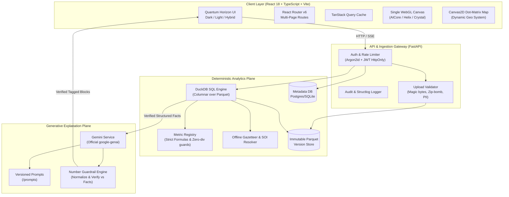

# BizLens System Architecture (ARCHITECTURE.md)

## 1. High-Level System Architecture

BizLens cleanly separates deterministic numerical computation from generative narrative explanation.

---

## 2. Ingestion & Storage Model

1. **Parquet-Centric**: Raw data files (CSV, XLSX, XLS) are validated, scanned for PII, and converted to columnar Parquet files stored under `STORAGE_ROOT/{dataset_id}/{version_id}.parquet`.
2. **Immutability**: Every transformation (deduplication, date parsing, category merging) writes a new Parquet file and produces a new `dataset_versions` record.
3. **Optimistic Locking**: The `lock_version` column in `dataset_versions` prevents concurrent destructive writes.

---

## 3. Data Integrity & AI Grounding

1. **Fact Representation**: Every metric calculated by DuckDB is packaged into a `Fact` object carrying `id`, `metric_id`, `value`, `display`, and `lineage_ref`.
2. **Untrusted Data Boundary**: Column headers and row contents are treated as untrusted data and wrapped in non-executable text delimiters before being sent to Gemini. Full raw rows are **never** passed to Gemini.
3. **Number Guardrail**: Post-response verification parses all numeric tokens, numbers written as words, percentages, and currencies, matching them against the supplied `Fact` set within rounding precision. If unverified numbers are found, a single strict retry is attempted. If it fails again, the engine provides the facts-only view with an explicit notice.

---

## 4. Multi-Theme Design System & Canvas Isolation

1. **Tokens**: Pure CSS custom properties applied on `<html data-theme="dark|light|hybrid">`.
2. **WebGL Constraint**: Exactly **one** WebGL canvas is permitted per page at any time to guarantee 60fps performance and low memory footprints.
3. **Accessibility**: All interactive elements support keyboard navigation, ARIA live regions for streaming content, and meet WCAG AA contrast standards.
